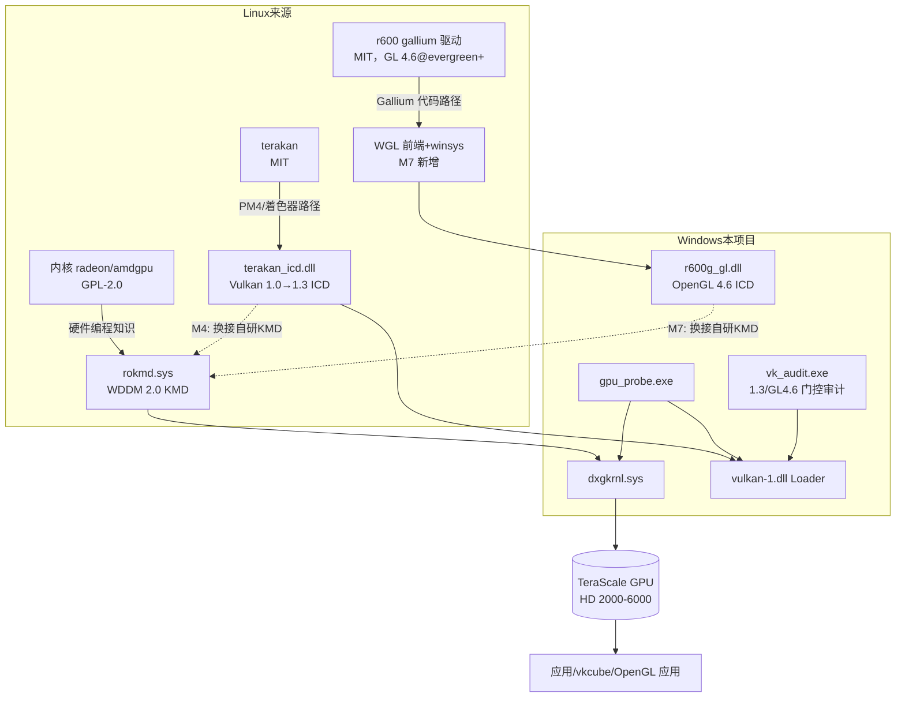

# 总体架构：开源 Radeon 栈 × Windows

本文是整个项目的技术总纲：Windows 图形栈如何运作、Linux 开源栈长什么样、
两者之间的鸿沟在哪里，以及我们打算怎么桥接。

---

## 1. Windows 图形栈（我们要适配的一侧）

Windows 上所有 GPU 都必须以 **WDDM（Windows Display Driver Model）** 的方式接入。
每个 GPU 厂商要交付**两个**驱动组件：

```
┌─────────────────────────────────────────────────────────────┐
│ 应用：游戏 / D3D12 / D3D11 / Vulkan / OpenGL / CL            │
├─────────────────────────────────────────────────────────────┤
│ 系统库：d3d12.dll / d3d11.dll / vulkan-1.dll(Loader) / opengl32.dll
├──────────────────────────┬──────────────────────────────────┤
│ UMD（用户态显示驱动）      │  ICD（安装型客户端驱动，Vulkan）   │
│  vendor UMD.dll           │  vendor vulkan.dll + ICD JSON    │
│  实现 D3D DDI（内核定义    │  直接面向 GPU 命令流              │
│  的接口集）                │                                  │
├──────────────────────────┴──────────────────────────────────┤
│ DirectX 图形内核 dxgkrnl.sys + VidMm(显存管理器) + 调度器      │
├─────────────────────────────────────────────────────────────┤
│ KMD（内核态显示微型端口）rokmd.sys ← 本项目要写的部分          │
│  实现 DXGK DDI：DxgkDdiAddDevice / StartDevice / SubmitCommand│
│  / CreateAllocation / MakeResident / Present / ...           │
├─────────────────────────────────────────────────────────────┤
│ PCIe 设备：BAR0 寄存器窗口、BAR2 VRAM、MSI 中断                │
└─────────────────────────────────────────────────────────────┘
```

要点：

- **KMD 不直接实现 API**。它向 dxgkrnl 注册一组 `DxgkDdi*` 回调（DDI = Driver-Device
  Interface），由操作系统在恰当时机调用。显存管理（VidMm）、跨进程调度、DWM 合成都
  是 OS 的工作，KMD 只负责"驱动硬件"。
- **UMD/ICD 是纯用户态 DLL**，通过 OS 提供的内核服务句柄（adapter handle / context
  handle）与 KMD 间接交互，自己填 GPU 命令流（AMD 术语：PM4 包）。
- WDDM 2.0（Windows 10 1507 引入）相对 1.x 的核心变化：**重写内存驻留模型**
  （`DxgkDdiMakeResident` / `DxgkDdiEvict` 取代旧的 pin 语义）、原生虚拟寻址、
  显著降低提交开销、`DxgkDdiSubmitCommandVirtual`（按 GPU 虚拟地址提交）。
  这些恰恰与 Linux 侧 amdgpu 的 GTTLB（GPU 页表）+ 用户态队列模型可以一一对应。

### 1.1 KMD 骨架必须实现的 DXGK DDI（首批）

下表是 `kmd/src` 骨架的 DDI 分工（完整清单以 WDK `d3dkmddi.h` 为准，
官方文档：[learn.microsoft.com WDDM display](https://learn.microsoft.com/en-us/windows-hardware/drivers/display/)）：

| DDI | 作用 | 对应 Linux radeon 概念 |
| --- | --- | --- |
| `DxgkDdiAddDevice` | 绑定 PDO，创建 miniport 上下文 | `pci_probe` + `drm_device` 分配 |
| `DxgkDdiStartDevice` | 拿 MMIO BAR/IRQ 资源，初始化硬件 | `radeon_device_init`（起步） |
| `DxgkDdiStopDevice` / `RemoveDevice` | 反初始化 / 释放 | `radeon_device_fini` |
| `DxgkDdiQueryAdapterInfo` | 报告驱动版本、适配器信息 | `.get_xxx_info` 回调 |
| `DxgkDdiCreateAllocation` / `DestroyAllocation` | 分配 VRAM/GTT 对象 | TTM buffer object |
| `DxgkDdiMakeResident` / `Evict`（2.0） | 驻留/逐出 | TTM 迁移 + `ttm_bo_validate` |
| `DxgkDdiBuildPagingBuffer` | 生成页表迁移命令 | `radeon_gart` VM 更新包 |
| `DxgkDdiCreateContext` / `DestroyContext` | 渲染上下文 | ring / ib 调度实体 |
| `DxgkDdiSubmitCommand` / `SubmitCommandVirtual` | 提交命令缓冲（IB） | `radeon_ib_get` + `radeon_ring_commit`（PM4 INDIRECT_BUFFER） |
| `DxgkDdiPreemptCommand` / `Patch` | 抢占 / 重定位打补丁 | ring 溢出处理 / relocation |
| `DxgkDdiPresent` | 显示路径翻转 | `radeon_crtc_page_flip` |
| `DxgkDdiInterruptRoutine` / `DpcRoutine` | MSI/DPC 中断 | `radeon_irq_kms` + IH ring |
| `DxgkDdiResetFromTimeout` | TDR 恢复 | GPU reset（r600_gpu_reset） |

> TeraScale（r600 家族）的硬件编程序列参考 Linux 内核
> `drivers/gpu/drm/radeon/r600.c` 等（GPL-2.0）：寄存器（`GRBM_*`、`CP_RB_*`、
> `MM_INDEX/MM_DATA`）、PM4 Type-3 包（`IT_INDIRECT_BUFFER`、`IT_PFP_SYNC_ME`…）、
> IH 中断环格式。这些是 M3 阶段移植的主体内容（许可影响见 licensing.md）。

## 2. Linux 开源栈（我们搬运的一侧）

```
┌───────────────────────────────────────────────────┐
│ 应用                                              │
├──────────────────────┬────────────────────────────┤
│ Vulkan: terakan(1.0→1.3,│ GL: r600(4.6, evergreen+； │
│  TeraScale) RADV(GCN)│  2025-06 Mesa 25.2 起)     │
│                      │ D3D12: 无（Proton 场景用    │
│                      │  vkd3d-proton=DX12→Vulkan） │
├──────────────────────┴────────────────────────────┤
│ libdrm（用户态内核接口封装 + 命令提交 ioctl）        │
├───────────────────────────────────────────────────┤
│ 内核 DRM：radeon（TeraScale，功能全）               │
│           amdgpu（GCN1+，活跃维护）                 │
│  GTTLB 页表 / TTM 显存管理 / ring·IB 调度 / IH 中断 │
└───────────────────────────────────────────────────┘
```

关键差异（也是移植工作量所在）：

| 能力 | Linux | Windows WDDM | 移植策略 |
| --- | --- | --- | --- |
| 显存管理 | TTM/GEM 在内核 | VidMm 在 OS，KMD 配合 | KMD 实现 CreateAllocation/MakeResident 即可，**比 Linux 简单** |
| GPU 页表 | KMD 编程 GTTLB | KMD 编程（同） | radeon 的 `r600_vm` 系列逻辑直接复用 |
| 命令提交 | 用户态 ring 写入 + ioctl 提交 IB | UMD 填 buffer，`SubmitCommand` 提交 | 形态几乎一致，是最大利好 |
| 中断 | DRM irq handler + IH ring | `InterruptRoutine` + DPC | 逻辑一致，包装层重写 |
| 显示 | DRM KMS（crtc/connector） | VidPn/Present DDI | 概念映射清晰但接口完全不同 |
| 电源 | KMD 全权（SMU/ATIF） | OS 通过 DDI 协商 | 先砍掉：性能换稳定（M3+ 再说） |

## 3. 三条技术路线

### 路线 A（先行）：terakan 用户态 Vulkan —— "站在官方 KMD 上"

terakan 证明 TeraScale 的 Vulkan 1.0 可以在 Windows 上跑起来（HD 6800/Barts，
2024-04 演示）。当前它依赖的环境与依赖边界（官方 KMD 是否必需、哪个版本）是
M1 的调研重点，结论会更新到 [research/terakan.md](research/terakan.md)。

**本路线价值**：最快让硬件出画面；为后续 KMD 提供用户态参照实现
（terakan 自己写好了 TeraScale 的 PM4/着色器编译路径）。

### 路线 B（核心）：自研 WDDM 2.0 KMD（`kmd/`）

把 Linux `radeon` KMD 的硬件知识（探测、GART/VM、ring、IH）装进 DXGK DDI 骨架。
阶段划分见 [roadmap.md](docs/roadmap.md)。骨架（M2）已经包含：

- `DriverEntry` → `DxgkInitialize` 注册 DDI 表
- `AddDevice/StartDevice`：PDO 绑定、资源枚举（BAR/IRQ）、日志
- 全量 DDI stub，返回 `STATUS_NOT_IMPLEMENTED` 并打日志（可观测优先）

### 路线 C（长线）：GL 4.6 与 DX12

- **GL 4.6（主路线 = R600g 原生移植，M7）**：Mesa r600 驱动已在 evergreen+
  （TeraScale 2/3）完成 GL 4.6（Mesa 25.2，2025-06；`features.txt` GL 4.6 行 +
  `r600_pipe.c:495` 硬件门），且无 LLVM 依赖。Windows 侧需新增 WDDM winsys +
  WGL 前端，**与 Vulkan 版本完全解耦**。方案见 [r600g-gl46.md](r600g-gl46.md)。
- **GL 4.6（备选 = Zink）**：GL-on-Vulkan；Mesa 官方 profile
  （VP_ZINK_gl46_baseline）要求 Vulkan 1.3 基座——M5.5 达成后门控全绿。
- **Vulkan 1.3（M5.5）**：terakan 逐特性冲 1.3（promoted 23/24/23 + 核心
  必选 24 项），计划见 [vulkan13-plan.md](vulkan13-plan.md)；
  门控/验证由 `umd/vk13/`、`tools/vk_audit/` 承担。
- **DX12**：Windows 不允许替换系统 `d3d12.dll` 的 DDI 语义；开源路径实质是
  vkd3d-proton 式 API 转换层（DX12 API → Vulkan），卡在 Vulkan 1.3 前置。
  M6 只做评估，不做承诺。

## 4. 组件依赖关系（Mermaid）



## 5. 风险清单

1. **DDI 签名漂移**：WDK 版本间 `DRIVER_INITIALIZATION_DATA` 字段增减，骨架以
   NuGet WDK 最新版为准，CI 报错即修。
2. **TDR/BSOD 迭代成本**：KMD 崩溃即蓝屏，M2/M3 阶段必须配双机调试（WinDbg +
   1394/网络）或 Hyper-V Gen1 实验机，`roadmap` 里安排了对应的验收门。
3. **Vulkan 1.3 与 GL 4.6 的依赖关系已解耦**：GL 4.6 主路线是 R600g 原生移植
   （不依赖 Vulkan 版本）；只有 Zink 备选路线和 DX12 转换层仍卡 Vulkan 1.3。
   该变更已同步到路线图（M5.5/M7），避免中途盲目加需求。
4. **许可混合**：GPL-2.0（内核移植段）与 MIT（新代码）必须按文件标注，
   详见 [licensing.md](licensing.md)。
5. **terakan 依赖边界未定**：若 terakan Windows 路径强依赖官方 Catalyst KMD，
   则 M4 之前它只能作为"参照实现 + 过渡方案"，结论以 M1 调研为准。
