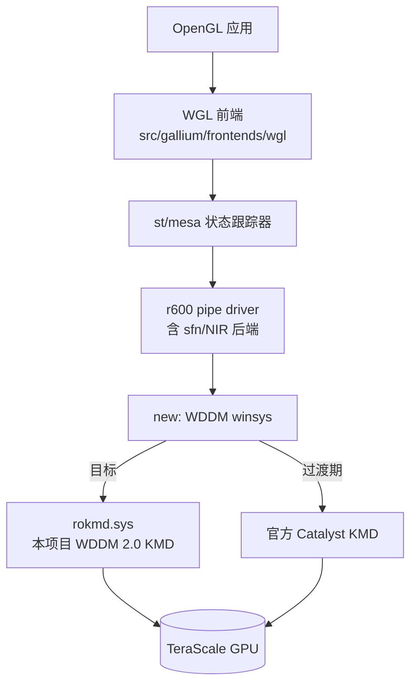

# OpenGL 4.6 路线：R600g 原生移植（主路线）与 Zink（备选）

> 决策：**OpenGL 驱动采用 R600g**（Mesa 的 TeraScale Gallium 驱动）原生移植到
> Windows。GL 4.6 因此与 Vulkan（terakan）**完全解耦**——不再依赖 terakan 先冲
> 1.3。Zink 降级为备选路线：当 R600g 移植受阻、且 Vulkan 1.3（M5.5）已达成时，
> 用 GL-on-Vulkan 兜底。
>
> 本文所有断言给出源码级出处（Mesa 26.2.6，2026-11 核对）。

---

## 1. 为什么是 R600g：三条权威依据

1. **官方功能矩阵**：Mesa `docs/features.txt`（docs.mesa3d.org 同步）GL 4.6 行
   首句即声明完成名单：
   > `GL 4.6, GLSL 4.60 -- all DONE: radeonsi, virgl, zink, iris, crocus/gen7+, d3d12, asahi, r600/evergreen+, llvmpipe`

   —— **r600 驱动在 evergreen 及以上（TeraScale 2/3）GL 4.6 全部完成**，
   本项目全部验证卡（Seymour/Turks、Caicos）属于该范围。

2. **驱动源码的版本门**：`src/gallium/drivers/r600/r600_pipe.c:494-495`
   ```c
   caps->glsl_feature_level_compatibility =
   caps->glsl_feature_level = family >= CHIP_CEDAR ? 460 : 330;
   ```
   硬件门就是一行：**CHIP_CEDAR（Evergreen）及以后 = GL 4.6；TeraScale 1
   （R600..RV740）= GL 3.3**。family 枚举顺序见
   `src/amd/common/amd_family.h`（CEDAR→…→BARTS→TURKS→CAICOS→CAYMAN→ARUBA）。

3. **时间线与活跃度**：r600 的 GL 4.6 于 **Mesa 25.2（2025-06）** 最终曝光
   （社区开发者 Patrick Lerda，Phoronix 2025-06-12 报道《OpenGL 4.6 Now Exposed
   For Old AMD Evergreen & Northern Islands GPUs》）；关键前置 ARB_gl_spirv 于
   Mesa 23.0（2023-01）落地。这说明该驱动**至今仍在活跃维护**，GL 4.6 不是
   僵尸能力。

> **对旧文档的修正**：本仓库早先的 api-matrix.md / architecture.md 写
> "r600 gallium 上限 4.5"，依据是 2021 年前的功能矩阵。以 Mesa 25.2 为界
> 该结论已过时，本轮已同步修订（见下文第 6 节引用变更）。

另外两个移植友好点：

- **无 LLVM 依赖**：`src/gallium/drivers/r600/meson.build` 不含任何 llvm 目标
  ——后端是自研汇编器（r600_asm.c）+ sfn C++ 前端（2022-09 起 r600 已切换
  NIR 基础设施），不存在 radeonsi 那样的 LLVM/ROCm 交叉编译负担。
- **许可证**：r600 是 MIT，与本项目新代码一致（见 licensing.md）。

## 2. 硬件门控（我们的卡能不能上 4.6）

| 验证对象 | PCI ID | Mesa 芯片类 | evergreen+？ | r600g GL 上限 |
| --- | --- | --- | --- | --- |
| HD 6490M（Seymour 营销名） | 0x6840/0x6841 | **TURKS**（r600_pci_ids.h:266-267） | ✅ | **4.6** |
| HD 7470M（Caicos） | 0x6779/0x677B | **CAICOS**（r600_pci_ids.h:288-289） | ✅ | **4.6** |
| TeraScale 1（R600–RV740，HD 2000–4000） | 0x9400…0x68F9 等 | R600..RV740 | ❌ | 3.3 |

PCI 全表（304 条，R600..ARUBA）已固化到 `umd/gl46/gl46_r600g.c`
（生成自 `include/pci_ids/r600_pci_ids.h`，MIT），供 vk_audit.exe 离线判定。

### GL 4.6 必选扩展 → Gallium cap 映射（st_extensions.c）

| GL 4.6 必选扩展 | Gallium cap | r600 状态（r600_pipe.c） |
| --- | --- | --- |
| ARB_gl_spirv / ARB_spirv_extensions | `caps.gl_spirv` | ✅ true（:464） |
| ARB_shader_group_vote | `caps.shader_group_vote` | ✅ true（:481） |
| ARB_polygon_offset_clamp | `caps.polygon_offset_clamp` | ✅ true（:443） |
| ARB_pipeline_statistics_query | `caps.query_pipeline_statistics` | ✅ true（:436） |
| ARB_shader_atomic_counter_ops | 原生原子计数器 | ✅ evergreen+（:611 `has_atomics`） |
| ARB_shader_draw_parameters | `caps.draw_parameters` | ✅ evergreen+（:521） |
| ARB_indirect_parameters | `caps.multi_draw_indirect_params` | ✅ evergreen+ 且 winsys 版本 ≥ 2.51.0（:522） |
| ARB_transform_feedback_overflow_query | `caps.query_so_overflow` | ✅ evergreen+（:453） |
| ARB_texture_filter_anisotropic | `caps.anisotropic_filter` | ✅ true（:411） |
| GL_KHR_no_error | 前端 driconf | ✅ 所有驱动 |
| （4.5 基础）ARB_texture_barrier | `caps.texture_barrier` | ✅ true（:429） |

门控逻辑同源固化：`umd/gl46/gl46_r600g.c`（单元测试覆盖 TURKS/CAICOS 通过、
R600 系判 3.3、winsys 版本不足报缺口等分支）。

## 3. Windows 移植架构



Windows 侧要写的只有一层：**WDDM winsys**（替代 Linux 的 drm winsys），
外加一个 Gallium target 把 WGL 前端与 r600 驱动链接成 `r600g_gl.dll`
（注册为系统 OpenGL ICD，或以 opengl32.dll 覆盖方式加载——安装期决策，
不影响架构）。

### winsys 服务映射（Linux drm winsys → WDDM）

| Linux（现有 r600 winsys） | Windows（要写的） | 对应 DDI / API |
| --- | --- | --- |
| bo 分配/驻留（GEM+TTM） | VidMm 分配请求 | `DxgkDdiCreateAllocation` / `MakeResident`（KMD 已在 M2/M3 计划内） |
| 命令提交（IB + ring ioctl） | 提交 PM4 IB | `DxgkDdiSubmitCommandVirtual` |
| fence / seqno 等待 | 监视围栏 + DPC | KMD IH 中断桥接 |
| 扫描出（KMS page flip） | Present 路径 | `DxgkDdiPresent` |
| drm 版本探测（:400，控制 indirect_params） | winsys 自报版本等价值 | ≥ r600_version_simple(2,51,0) |

### 工程切分与验收门

| 里程碑 | 内容 | 验收门 |
| --- | --- | --- |
| GL-W1 | winsys 骨架：分配/提交/围栏对接（官方 KMD 过渡） | clear + 单三角形 |
| GL-W2 | WGL 前端 + target 打包，glinfo 类工具可查 | wglinfo 报 renderer = r600 |
| GL-W3 | GL 3.3 级稳定性（TeraScale 1 同级交付共享） | glmark2 跑通 |
| GL-W4 | 4.x 逐级启用（依赖 r600 既有代码路径） | 每级扩展清单核对 |
| GL-W5 | GL 4.6 收口 + 一致性子集 | wglinfo 报 4.6；SPECviewperf 类冒烟 |

依赖关系：GL-W1 依赖 M3（KMD 具备 alloc/submit）；若接受"官方 Catalyst KMD
过渡"（同 terakan 现状），GL-W1 可提前并行启动。

## 4. 与 Vulkan 路线的关系

- **共享层**：PM4 编程、GPU VM 页表、IH 中断——r600g 与 terakan 各自实现，
  但底层 KMD 服务（M3/M4）完全复用。
- **不互相阻塞**：GL 4.6 不再等 Vulkan 1.3；terakan 冲 1.3（M5.5）是独立目标。
- **风险对冲**：若 GL-W 线进度不及预期，Vulkan 1.3 达成后 Zink 兜底（第 7 节）。

## 5. Zink 备选路线（GL-on-Vulkan）

前提：terakan 达到 **Vulkan 1.3**（M5.5 完成）。门控依据 Mesa 官方
机器可读 profile `src/util/VP_ZINK_requirements.json`：

- `VP_ZINK_gl46_baseline` 的 api-version 要求 = **1.3.0**；
- 相对基线链新增：VK_KHR_draw_indirect_count、
  VkPhysicalDeviceFeatures.**samplerAnisotropy**、**depthBiasClamp**；
- 初始化硬校验：`scalarBlockLayout`（或 VK_EXT_scalar_block_layout）
  ——`zink_screen.c:2893-2906`；
- ARB_shader_group_vote ← 子群组 VOTE 位 + COMPUTE 阶段
  ——`zink_screen.c:830-834`。

完整链（gl21→gl46 baseline：约 20 项核心 features、9 个非核心扩展、
7 项 limits、5 组格式要求）已编码为 `umd/gl46/gl46_zink.c`，
vk_audit.exe 的 [D] 段落即按它逐项报告缺口。

**定位**：备选/兜底。若 R600g 移植成功，Zink 无需启用；两者共享
`umd/vk13` 的 1.3 门控数据。

## 6. 本轮文档一致性修订

| 文档 | 修订 |
| --- | --- |
| docs/api-matrix.md | GL 4.6 行：❌→✅（r600/evergreen+，Mesa 25.2 起）；"Windows 开源 GL"行同步更新 |
| docs/architecture.md | 路线 C 改写：GL 4.6 主路线 = R600g 原生移植；Zink 备选；组件图加入 r600g 节点 |
| docs/wddm-vulkan-limits.md | 2.3 节追加 M5.5/M7 决策更新说明 |
| docs/roadmap.md | 新增 M5.5（Vulkan 1.3）与 M7（R600g GL 4.6）；原 M5 保留并加注 |
| README.md | 版本上限/矩阵/结构/路线图摘要同步 |

## 7. 参考链接

- Mesa features.txt（GL 4.6 → r600/evergreen+ DONE）:
  <https://docs.mesa3d.org/features.html>
- Phoronix: OpenGL 4.6 Now Exposed For Old AMD Evergreen & Northern Islands
  GPUs（Mesa 25.2，2025-06-12）:
  <https://www.phoronix.com/news/OpenGL-4.6-For-Radeon-R600g>
- Phoronix: R600g ARB_gl_spirv（Mesa 23.0，2023-01）:
  <https://www.phoronix.com/news/R600g-SPIR-V-ARB_gl_spirv>
- Mesa 26.2.6 源码（r600_pipe.c / st_extensions.c / amd_family.h /
  r600_pci_ids.h / VP_ZINK_requirements.json / zink_screen.c）:
  <https://gitlab.freedesktop.org/mesa/mesa>
